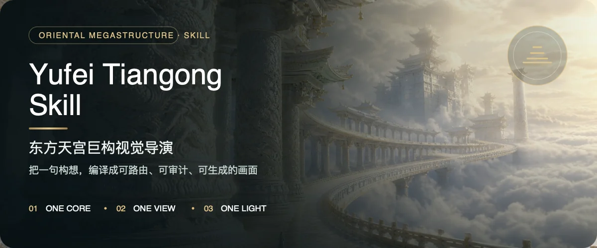
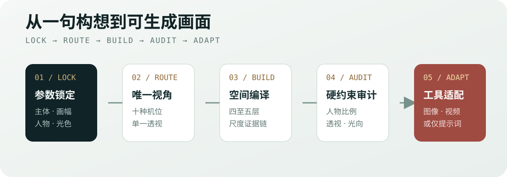

<p align="center">
  
</p>

<p align="center">
  将一句场景构想、已有提示词或视觉参考，编译成具有明确视角、可验证尺度和统一光色的东方巨构图像与视频提示词。
</p>

<p align="center">
  <code>Agent Skill</code> · <code>东方巨构</code> · <code>图像提示词</code> · <code>图生视频</code> · <code>Provider-neutral</code>
</p>

## 真实输出

这不是一组只负责“写得华丽”的提示词模板。Skill 会先固定唯一核心巨构、机位、空间层级、人物比例、光向与尺度证据，再把它们编译成可执行提示词。

<p align="center">
  
</p>

<p align="center">
  
  
</p>

> 展示图来自本项目的真实生成结果。模型与随机性会影响最终画面；Skill 提供的是结构化控制与失败修正方法，不承诺每次生成完全一致。

## 效果视频

<p align="center">
  <a href="./assets/readme/video/tiangong-demo.mp4">
    
  </a>
</p>

<p align="center">
  <a href="./assets/readme/video/tiangong-demo.mp4"><strong>▶ 点击观看 23 秒完整效果视频</strong></a>
  · 960×540 · H.264 · 无音乐
</p>

视频展示从静态东方巨构画面到统一运镜成片的结果。开源仓库提供无音乐版本，避免将仅用于本地节奏参考的音乐带入公开分发。

## 它解决什么问题

很多“东方史诗建筑”提示词最终会变成：人物过大、远宫缩成亭子、多个主体互相争夺、透视混乱、全画面橙金滤镜，或者只剩符号堆砌。

`yufei-tiangong-skill` 把这些模糊审美要求变成可检查的画面约束：

- **一个统治主体**：一张图只保留一个核心巨构、一个主导几何和一个主要奇观事件。
- **十种视角路由**：先确定唯一机位，再组织透视、裁切、人物和空间层级。
- **可观察尺度证据**：用人物、柱列、云层、开放距离和画框裁切证明“巨大”，不只写“史诗感”。
- **生成前后审计**：检查人物、前景、远方主体、家具比例、透视、云瀑与主光方向。
- **提供方解耦**：先生成平台无关的主提示词，再适配当前 Agent 真正拥有的图像或视频工具。
- **静态参数继承**：进入图生视频阶段后锁定源图结构，只编译一个明确运镜，不重新设计画面。

## 工作方式

<p align="center">
  
</p>

每次任务会从以下模式中选择一个主模式：

| 模式 | 用途 |
| --- | --- |
| 创建 | 将简短构想扩展成完整视觉导演方案与提示词 |
| 衍生 | 保留视觉 DNA，改变场景、时间或核心体量 |
| 优化 | 重写已有提示词，提高层级、比例与可控性 |
| 诊断 | 定位人物、前景、主体、透视、光色或云瀑问题 |
| 变体 | 在硬约束不变的前提下生成真正不同的方向 |
| 直接生图 | 当前 Agent 有已授权生图工具时执行生成 |
| 图生视频 | 继承静态画面并编译唯一运镜 |

## 安装

### 一条命令安装

如果本机有 Node.js，可使用通用 Skills 安装器：

```bash
npx skills add captainyufei/yufei-tiangong-skill
```

安装完成后重启 Agent，然后使用 `$yufei-tiangong-skill` 调用。

### 手动安装

也可以把仓库克隆到对应 Agent 的技能目录：

**Codex**

```bash
git clone https://github.com/captainyufei/yufei-tiangong-skill.git \
  ~/.codex/skills/yufei-tiangong-skill
```

**Claude Code**

```bash
git clone https://github.com/captainyufei/yufei-tiangong-skill.git \
  ~/.claude/skills/yufei-tiangong-skill
```

**共享 Agent Skills 目录**

```bash
git clone https://github.com/captainyufei/yufei-tiangong-skill.git \
  ~/.agents/skills/yufei-tiangong-skill
```

常见安装位置：

| 环境 | 目录示例 |
| --- | --- |
| Codex | `~/.codex/skills/yufei-tiangong-skill/` |
| Claude Code | `~/.claude/skills/yufei-tiangong-skill/` |
| 共享 Agent Skills 目录 | `~/.agents/skills/yufei-tiangong-skill/` |

安装后重新启动 Agent，确认它能发现 `SKILL.md`。如果运行环境不支持自动加载 Agent Skills，也可以在对话中提供 `SKILL.md` 及其 `references/` 目录作为上下文。

本 Skill 不自带模型账号、API Key、调用额度或图像/视频生成服务。提示词生成和诊断可以独立工作；直接生图或生成视频取决于当前 Agent 是否拥有已授权工具。

## 第一次使用

直接指定 Skill：

```text
使用 $yufei-tiangong-skill，生成一座悬浮在云海上的白玉天宫。
远方主体必须仍然巨大，一名背影人物站在窄台边缘，16:9。
```

只要可复制提示词：

```text
使用 $yufei-tiangong-skill 优化下面的提示词。
只返回完整提示词和负面约束，不要直接生图：

一座东方天宫漂浮在云海上，电影感，人物仰望。
```

诊断已有结果：

```text
使用 $yufei-tiangong-skill 诊断这张图。
重点检查人物是否过大、远宫是否过小、前景是否膨胀，以及主光方向是否统一。
```

制作图生视频提示词：

```text
使用 $yufei-tiangong-skill 将这张图编译成图生视频提示词。
锁定建筑、人物、云海和光向，只使用一个缓慢运镜。
```

## 默认输出

除非你要求精简格式，提示词任务会返回：

1. **参数锁定**：区分用户输入与默认补充。
2. **视觉导演方案**：说明视角、主体、空间、尺度和光色。
3. **完整提示词**：一段可复制文本。
4. **负面约束**：独立列出当前视角的关键禁忌。
5. **审计结果**：说明硬约束是否通过，以及修正了什么。

## 目录结构

```text
yufei-tiangong-skill/
├── SKILL.md
├── agents/
│   └── openai.yaml
├── assets/
│   └── readme/
└── references/
    ├── master-rules.md
    ├── viewpoint-routes.md
    ├── viewpoint-prompts.md
    ├── scale-audit.md
    ├── style-bible.md
    ├── prompt-recipes.md
    ├── provider-adapters.md
    └── video-motion.md
```

`SKILL.md` 负责路由与执行流程；`references/` 保存共享美术规则、十种机位、尺度审计、工具适配和视频运动规范。Agent 只在任务需要时加载对应材料。

## 兼容性与边界

- 核心内容采用 `SKILL.md + references` 结构，适用于支持 Agent Skills 的运行环境。
- `agents/openai.yaml` 提供 OpenAI/Codex 界面元数据；其他运行环境可以忽略它。
- 没有可用生图或视频工具时，Skill 会返回完整提示词，不会假装已经生成。
- 指定 Seedream 或其他提供方时，只使用当前接口明确支持的字段，不臆造模型参数。
- 参考图只用于重建空间、比例、层级与光向，不复制界面、文字、水印或无关人物。

## 许可证

本项目采用 [MIT License](./LICENSE) 开源。你可以使用、复制、修改和分发，但需保留原始版权与许可声明。
